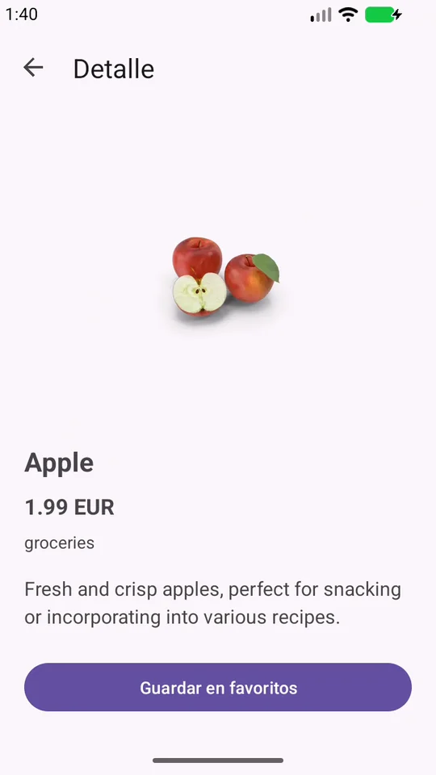

# Tienda Android

Catálogo sin conexión en Kotlin. Guarda **Apple**, cierra la app y vuelve a abrirla. En **Favoritos** aparece la misma manzana a **1,99 €**, recuperada de SQLite.

[Descargar el APK para Android 9 o posterior](https://github.com/shaw207/tienda-android/releases/download/v1.0.0/Tienda-Android.apk)

## Compilar

Abre el proyecto en Android Studio con JDK 21 y Android SDK 36. En Windows puedes compilar con `.\gradlew.bat :app:assembleDebug`.

Datos e imágenes del catálogo de [DummyJSON](https://dummyjson.com/products).
